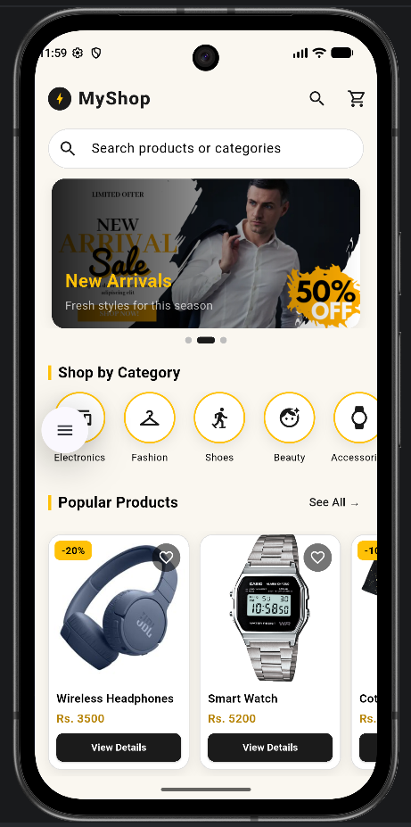
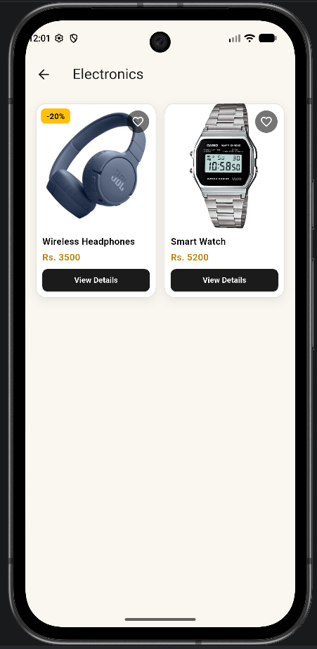
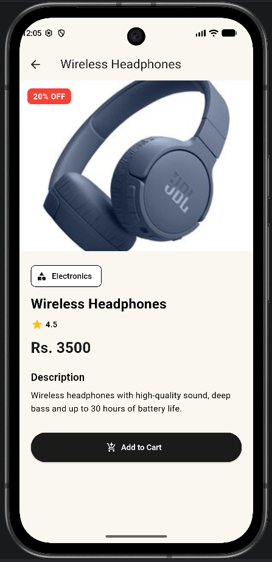
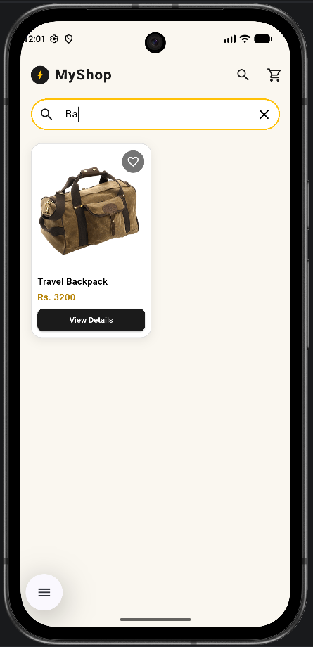
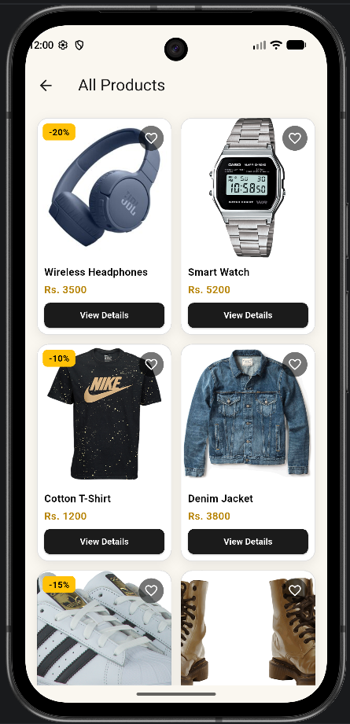

# MyShop

A small shopping app made with Flutter for the Mobile Application Development course.

**Name:** Pujan Rasaili  
**Student ID:** 2528898  
**Course:** Mobile Application Development

## About

This is my assignment for the Flutter mini e-commerce app. The app shows products in different categories. You can open a category to see its products in a grid, and open any product to see its details. There is no login, payment or backend. All the product data is written inside the app in `lib/data/product_data.dart`.

## What the app has

- Home page with an app bar (name, search icon, cart icon)
- Banner slider with 3 banners, tapping a banner opens its category
- Categories in a horizontal scroll (Electronics, Fashion, Shoes, Beauty, Accessories, Home)
- Popular Products list and a "See All" button
- One reusable `ProductCard` used on the home page, the category page and the search results
- Category page with a `GridView.builder`, it receives the category name and shows only that category's products
- Product details page with image, name, price, rating, category, description and an Add to Cart button (shows a SnackBar)
- Search bar on the home page, it filters products by name or category while typing
- 6 categories and 12 products

## Screenshots

  

Home page, category page, product details page

 

Search, and the "See All" page

## Packages used

- `carousel_slider` ([pub.dev](https://pub.dev/packages/carousel_slider)) - I used it for the banner slider on the home page. It slides the banners automatically and lets the user swipe. The code is in `lib/widgets/banner_carousel.dart`.

## How to run

1. Install Flutter and set up an emulator or a phone.
2. Clone the project with `git clone https://github.com/pujanrasaili/mini-ecommerce-flutter.git`
3. Go into the folder with `cd mini-ecommerce-flutter`
4. Get the packages with `flutter pub get`
5. Start the app with `flutter run`

## Folders

- `lib/main.dart` - app start and theme
- `lib/models/` - product and category classes
- `lib/data/` - the product list
- `lib/screens/` - home, category and product details pages
- `lib/widgets/` - product card, category item, banner slider, image widget
- `lib/theme/` - colors
- `assets/images/` - product and banner pictures
- `screenshots/` - screenshots used in this file
